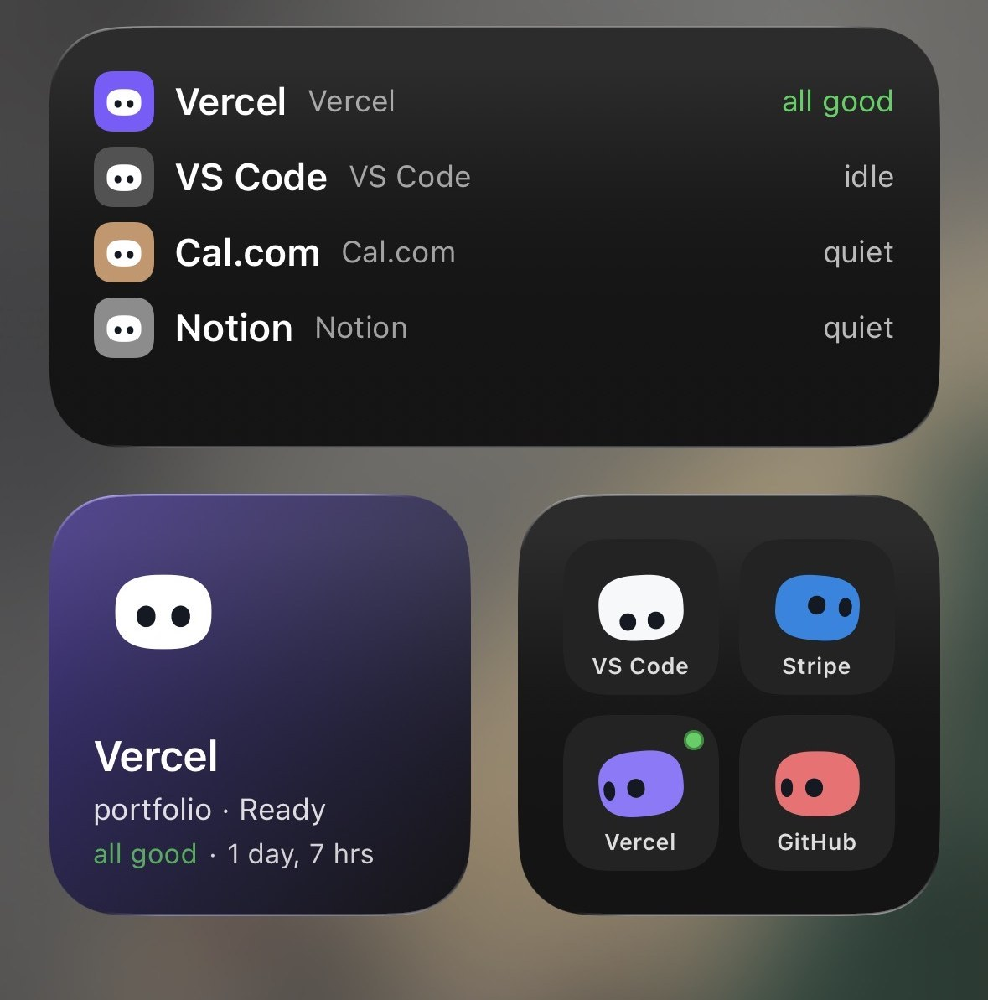
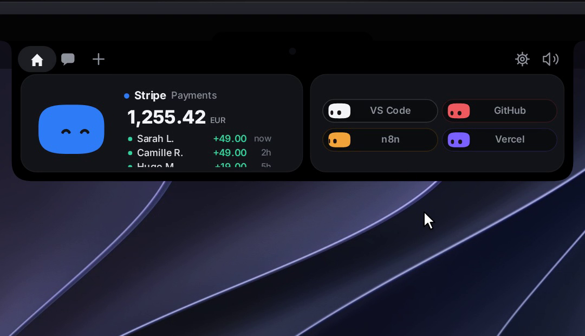

<div align="center">


# Nala

**The intelligent notch companion & dynamic island for AI coding agents.**  
*Available on macOS, Windows, Linux, iOS, and Android.*

Approve permissions, monitor agent sessions in real-time, inspect diffs, drop files, and chat with AI models — all without breaking your flow. Step away from your desk, and your companion seamlessly follows you to your phone with live updates, widgets, and biometric approvals.

Hold a key anywhere to dictate with offline AI speech recognition, or record meeting calls locally to get automated transcripts, summaries, and action items — free, open-source, and private.

[](https://github.com/gilangggra/Nala/releases)


<br>


</div>

---

## 📑 Table of Contents

- [Why Nala?](#why-nala)
- [Meet Mochi](#meet-mochi)
- [Flow: Voice Dictation & Call Notetaker](#flow-voice-dictation--call-notetaker)
- [Core Features](#core-features)
- [Mobile Companions](#mobile-companions)
  - [Nala on iPhone](#nala-on-iphone)
  - [Nala for Android](#nala-for-android)
- [Interactive Gestures](#interactive-gestures)
- [Demo Mode](#demo-mode)
- [Installation](#installation)
  - [macOS](#macos)
  - [Windows](#windows)
  - [Linux](#linux)
  - [NixOS](#nixos)
  - [iPhone](#iphone)
  - [Android](#android)
  - [Build from Source](#build-from-source)
- [Setup & Hooks](#setup--hooks)
  - [Supported Agents](#supported-agents)
  - [WhatsApp Integration](#whatsapp-experimental)
- [How It Works](#how-it-works)
- [Release Notes](#release-notes)
- [Contributing](#contributing)
- [License](#license)

---

## Why Nala?

Some studios showed off gorgeous notch companions… and never let anyone use them.

**Nala is the open-source alternative.** Every line of code is open source under the MIT License: read it, fork it, customize it, and learn from it.

Developers spend their days interacting with autonomous AI coding agents like Claude Code, Codex, Cursor, Gemini CLI, and Antigravity. Constantly switching context to your terminal just to click "Allow" breaks your creative focus. Nala brings your agents into your peripheral vision through a native notch companion or smooth desktop island that lets you approve commands, watch progress, and take action with zero friction.

---

## Meet Mochi

**Mochi** is your desktop companion: a soft little squircle with big, curious eyes that lives in your notch (or slides out from the top of your screen on Windows and Linux).

- 👋 **Alive and responsive** — waves hello on launch, blinks, breathes, and follows your cursor across the display.
- 🎯 **Agent-aware** — celebrates when your agent finishes a task, gets dizzy when clicked repeatedly, and raises alerts when input is needed.
- 🖥️ **Desktop freedom** — drag Mochi out of the notch to float anywhere on your desktop as an interactive desktop pet.
- 👗 **Wardrobe & themes** — customize Mochi's appearance with outfits, accessories, and seasonal costumes.

---

## Flow: Voice Dictation & Call Notetaker

<div align="center">

</div>

Nala includes a complete desktop voice suite built right in:

- 🎙️ **Flow Dictation** — Hold a hotkey anywhere on your system (Right ⌥, fn, Right Ctrl, etc.), speak naturally, and release: your words are instantly pasted into whichever app is active. Includes one-tap/double-tap hands-free mode, Esc to cancel, and clipboard preservation.
- 💊 **Floating Pill** — A subtle, translucent pill resting on your screen edge. Hover to access quick actions: dictate, record, or open settings. Nine reactive dots dance to your voice as you speak.
- 🦜 **Dual Offline Speech Engines (Whisper Large-v3 Turbo & Parakeet)** — Run **OpenAI Whisper Large-v3 Turbo (INT8)** for high-accuracy Bahasa Indonesia and 99+ multilingual support, or **NVIDIA Parakeet TDT** across 25 Western languages — 100% locally on your device via `sherpa-onnx` and neural hardware acceleration with zero audio ever leaving your machine.
- ✍️ **Intelligent Text Polishing** — Configure a custom dictionary of names and technical terms, define snippet expansions, and optionally polish text with AI (as said, natural, or professional).
- 📝 **Private Call Notetaker** — Record your microphone and computer audio with zero awkward third-party meeting bots. Generates speaker-separated transcripts, summaries, and actionable to-do lists locally or via your preferred AI provider. Audio is deleted once the transcript is complete.
- 📊 **Local Analytics** — Track dictated word counts, time saved, typing speed (WPM), and app usage — all calculated locally and never synced externally.

<table>
<tr>
<td width="33%"></td>
<td width="33%"></td>
<td width="33%"></td>
</tr>
</table>

---

## Core Features

- 🤖 **Universal Coding Agent Hub** — Live monitoring for **Claude Code, Cursor, Codex, Gemini CLI, Antigravity, Copilot CLI, Muse Code, OpenCode, Amp, Hermes, Claude Desktop**, and custom agents. Watch file edits step-by-step with real-time `+N / -M` line counts and diffs.
- ✅ **One-Click Approvals** — Claude Code permission prompts display directly in the island with **Allow / Deny / Always**. Interactive `AskUserQuestion` prompts support single and multi-select choices right from the notch.
- 🧑‍💻 **Jump to Terminal** — Instantly bring the exact terminal window running your active session to the front.
- 💬 **Multi-Model AI Chat** — Chat with Claude, Gemini, OpenAI, DeepSeek, Qwen, Moonshot, or local models via Ollama and LM Studio.
- 💳 **Subscription Tunneling (No API Key Required)** — Route chat requests through the official CLI tools you already pay for (Claude Code, Antigravity, Gemini CLI, Codex, Cursor, Copilot) without needing individual paid API keys.
- 📈 **Crypto Portfolio Pill** — Track assets across 16 blockchains and 5 major exchanges with live balances, 7-day sparklines, and 24-hour price deltas. Uses read-only public keys — completely private.
- 📊 **Plan Usage Gauges** — Monitor your Claude and Codex rate limits and reset countdowns at a glance.
- ✉️ **Integrated Mail** — Search inboxes, apply smart filters (Unread, Important, Today), and trigger AI-assisted email sorting and drafting (Apple Mail on macOS, classic Outlook on Windows).
- 📎 **Drag-and-Drop Ingestion** — Drop any file onto Mochi to summarize it, ask questions, or attach it to an email. Drag Mochi onto an app window to include it as context.
- 🔌 **Productivity Integrations** — Dedicated pills for GitHub (PRs, reviews, CI status), Stripe revenue, Vercel deployments, Resend, Notion, and Cal.com.
- 🎵 **Media Controller** — Apple Music and Spotify pills with album artwork, interactive seek bars, and playback controls while Mochi dances along.
- 🗣️ **« OK Nala » Voice Control** — Multilingual voice interaction (including Bahasa Indonesia, English, and French) for system control, querying service balances, controlling music, and drafting emails, with localized speech synthesis (`id-ID`, `en-US`, `fr-FR`) and ElevenLabs support.
- 🌍 **Internationalization** — Native localization in 16 languages, including English, 简体中文, 繁體中文, हिन्दी, Español, العربية, Français, বাংলা, Português, Русский, Bahasa Indonesia, Deutsch, Türkçe, ไทย, 한국어, and 日本語.
- 🔒 **Zero Telemetry, Private by Design** — No user accounts, no tracking. Credentials stay in your OS Keychain, Windows Credential Manager, or Linux Secret Service.

---

## Mobile Companions

### Nala on iPhone

When you step away from your desk, Nala transfers your active sessions to your iPhone:

<table>
<tr>
<td colspan="3" align="center"></td>
</tr>
<tr>
<td width="33%"></td>
<td width="33%"></td>
<td width="33%"></td>
</tr>
</table>

- 🏝️ **Live Activities & Dynamic Island** — Locking your Mac transitions Mochi to your iPhone's Dynamic Island and Lock Screen.
- 🔐 **Face ID Biometric Approvals** — Approve or deny agent execution with Face ID confirmation. Your Mac only executes decisions matching active requests.
- 💬 **Live Session Control** — Inspect terminal diffs, answer questions, and submit follow-up prompts using text or voice.
- 🧩 **Widgets & Siri Shortcuts** — Home Screen widgets, Control Center tiles, and full Siri integration.
- 🔒 **End-to-End iCloud Sync** — Sessions sync privately through your personal CloudKit database with client-side encryption. No third-party servers involved.

*Full iPhone guide and configuration: [docs/IPHONE.md](docs/IPHONE.md).*

---

### Nala for Android

The native Android app brings Mochi and your agents to Android devices:

- 🔐 **Remote Biometric Approvals** — Permission requests appear over any screen or lock screen; approve with your fingerprint or device PIN.
- 🏝️ **Floating Camera Island** — Dynamic overlay dropped from the camera punch-hole during active tasks, with a persistent quick-settings tile.
- 🧩 **Custom Home Screen Widgets** — 9 distinct widgets providing agent status indicators, plan usage meters, and quick actions.
- 🔒 **Direct Local Wi-Fi Pairing** — Connects directly to your computer over local Wi-Fi with QR pairing and pinned TLS certificates. Completely offline.

*Full Android guide and setup: [android/README.md](android/README.md).*

<table>
<tr>
<td></td>
<td></td>
</tr>
<tr>
<td></td>
<td></td>
</tr>
</table>

---

## Interactive Gestures

| Action | Mochi's Reaction |
|---|---|
| Hover the notch / top screen edge | Peeks out and waves 👋 |
| Click the island | Expands overview panel |
| Hover over Mochi | Blinks and eyes enlarge |
| Click Mochi | Squishes with an annoyed emote |
| Rapid triple-click | 😵‍💫 Becomes dizzy temporarily |
| Drop a file onto the island | Transforms into a box and swallows the file |
| Drag Mochi onto an app window *(macOS)* | Attaches window context to chat |
| Click AI model name in chat | Switches AI provider or model |
| Say « OK Nala » | Activates listening mode |
| Hold dictation hotkey and speak | Transcribes voice and pastes into active app |

---

## Demo Mode

Want to test Nala without setting up API keys or coding agents?

Open **Settings → General → Demo** and click **Try demo mode**. Nala will run a fully interactive scripted preview showcasing:
- Live Claude Code session with real-time diffs and terminal steps.
- Interactive permission requests and user question dialogs.
- Pre-populated GitHub, Stripe, and Vercel integration pills.
- Streamed AI chat responses and weekly recap visualizations.

No files, keys, or hooks are modified during demo mode.

---

## Installation

### macOS

#### Homebrew (Recommended)

```bash
brew tap gilangggra/nala https://github.com/gilangggra/Nala
brew install --cask nala
```

To update in the future:
```bash
brew upgrade --cask --greedy nala
```

#### Direct Download

1. Download the latest `Nala.zip` from [GitHub Releases](https://github.com/gilangggra/Nala/releases).
2. Unzip and drag `Nala.app` to your `/Applications` directory.
3. Launch the app and grant Accessibility/Microphone permissions when prompted for Flow dictation.

---

### Windows

Download the latest installer from [GitHub Releases](https://github.com/gilangggra/Nala/releases):

- **[Nala-Windows.msi](https://github.com/gilangggra/Nala/releases/download/windows-latest/Nala-Windows.msi)** — System-wide Windows Installer.
- **[Nala-Windows-setup.exe](https://github.com/gilangggra/Nala/releases/download/windows-latest/Nala-Windows-setup.exe)** — Per-user installer (no administrative elevation needed).

> [!NOTE]
> **SmartScreen Prompt**: If Windows displays an "Unknown publisher" warning, click **More info** → **Run anyway**. Nala is open source and cleanly verified by Microsoft Defender.

---

### Linux

Download the latest Linux packages from [GitHub Releases](https://github.com/gilangggra/Nala/releases):

- **AppImage (Universal)**:
  ```bash
  chmod +x Nala-Linux-*.AppImage
  ./Nala-Linux-*.AppImage
  ```
- **Debian / Ubuntu (.deb)**:
  ```bash
  sudo apt install ./Nala-Linux-*.deb
  ```
- **Fedora / openSUSE (.rpm)**:
  ```bash
  sudo dnf install ./Nala-Linux-*.rpm
  ```
- **Arch Linux**: Build using the included [PKGBUILD](linux/arch/PKGBUILD).

On Wayland compositors supporting `gtk-layer-shell` (KDE Plasma, Hyprland, Sway, COSMIC), Nala docks seamlessly to the screen edge. On GNOME, it runs via XWayland as a top dock.

---

### NixOS

Nala provides a native Nix flake for `x86_64-linux` and `aarch64-linux`.

**Run directly:**
```bash
nix run github:gilangggra/Nala
```

**Add to configuration.nix:**
```nix
{
  inputs = {
    nixpkgs.url = "github:NixOS/nixpkgs/nixos-unstable";
    nala.url = "github:gilangggra/Nala";
  };

  outputs = { nixpkgs, nala, ... }: {
    nixosConfigurations.my-machine = nixpkgs.lib.nixosSystem {
      modules = [
        ./configuration.nix
        ({ pkgs, ... }: {
          environment.systemPackages = [
            nala.packages.${pkgs.stdenv.hostPlatform.system}.default
          ];
        })
      ];
    };
  };
}
```

---

### iPhone

1. Install [TestFlight](https://apps.apple.com/app/testflight/id899247664) from the App Store.
2. [Join the Nala TestFlight Beta](https://testflight.apple.com/join/3GpeHv2b).
3. On your Mac: Open **Settings → General → iPhone** and enable **Show my agent sessions on my iPhone**.
4. Ensure both devices share the same iCloud Apple Account.

---

### Android

1. Download the latest signed `Nala-Android.apk` from [GitHub Releases](https://github.com/gilangggra/Nala/releases).
2. On your computer: Open Nala **Settings → Android phone** and toggle **Phone link**.
3. Scan the generated pairing QR code with the Android app on the same local Wi-Fi network.

---

### Build from Source

#### macOS (XcodeGen)
Requires macOS 15+, Xcode 16+, and [XcodeGen](https://github.com/yonaskolb/XcodeGen).
```bash
brew install xcodegen
git clone https://github.com/gilangggra/Nala.git
cd Nala/NotchBuddy
xcodegen
open NotchBuddy.xcodeproj
```

#### Windows (Tauri 2 + Rust)
Requires [Rust](https://rustup.rs), Node.js 20+, and C++ Build Tools.
```powershell
git clone https://github.com/gilangggra/Nala.git
cd Nala/windows
npm install
npm run pack
```

#### Linux
Requires [Rust](https://rustup.rs), Node.js 20+, WebKitGTK, and layer-shell development headers.
```bash
sudo apt install build-essential pkg-config \
  libwebkit2gtk-4.1-dev libgtk-layer-shell-dev libayatana-appindicator3-dev \
  librsvg2-dev libssl-dev libdbus-1-dev patchelf \
  gstreamer1.0-plugins-base gstreamer1.0-plugins-good
git clone https://github.com/gilangggra/Nala.git
cd Nala/windows
npm install
npm run pack
```

#### Android
Requires JDK 17 and Android SDK (API 35).
```bash
git clone https://github.com/gilangggra/Nala.git
cd Nala/android
./gradlew assembleDebug
```

---

## Setup & Hooks

Access the settings window via the Dock/menu bar on macOS (⌘,), or via the system tray on Windows and Linux.

| Integration | Purpose | Configuration Path |
|---|---|---|
| **Claude Code** | Live sessions & approvals | **Install hooks** — safely backs up `~/.claude/settings.json` and inserts relay hooks |
| **Antigravity (agy)** | Live sessions & notch approvals | Settings → Antigravity → **Install hooks** |
| **Gemini CLI** | Live sessions | Settings → Gemini CLI → **Install hooks** |
| **Codex CLI** | Live sessions & approvals | Settings → Codex → **Install hooks** |
| **API Keys** | AI Chat (Claude, OpenAI, Gemini, etc.) | Settings → Chat (stored in OS Credential Vault) |
| **Local LLMs** | Ollama / LM Studio connection | Settings → Chat → Local models → **Connect** |
| **Flow Dictation** | Speech-to-text hotkey & language | Settings → Flow → Settings |
| **Offline Speech Models** | Local voice recognition (Whisper Large-v3 Turbo / Parakeet) | Settings → Flow → Recognition → **Download** |
| **iPhone Link** | iOS Live Activity & approvals | Settings → General → iPhone (iCloud CloudKit) |
| **Android Link** | Android approvals & widgets | Settings → Android phone (Local Wi-Fi pairing) |
| **Services** | GitHub, Stripe, Vercel, Resend, Notion | Settings → Active pills |

> [!TIP]
> If Nala is closed, hook scripts exit immediately with zero latency. **Your CLI coding sessions are never blocked.**

---

### Supported Agents

| Agent | Connection Method | Platforms |
|---|---|---|
| **Claude Code** | Native settings hook | macOS, Windows, Linux |
| **Antigravity** | Native config hook | macOS, Windows, Linux |
| **Gemini CLI** | Native settings hook | macOS, Windows, Linux |
| **Cursor** | Automatic hook detection | macOS, Windows, Linux |
| **Codex** | `--agent codex` flag / hook | macOS, Windows, Linux |
| **Copilot CLI** | `--agent copilot` flag | macOS, Windows, Linux |
| **Muse Code** | `--agent muse` flag | macOS, Windows, Linux |
| **OpenCode** | Plugin: Settings → OpenCode Plugin | macOS, Windows, Linux |
| **Amp** | Plugin: Settings → Amp Plugin | macOS, Windows, Linux |
| **Hermes** | Plugin: Settings → Hermes | macOS, Windows, Linux |
| **Custom Agents** | Generic `--agent <name>` flag (see [docs/AGENTS.md](docs/AGENTS.md)) | macOS, Windows, Linux |

*For agents running on remote servers or SSH containers, see [docs/REMOTE.md](docs/REMOTE.md).*

---

### WhatsApp (Experimental)

*Available on macOS (GitHub build), Windows, and Linux.*

Monitor conversations and send replies directly from your notch or dynamic island via an open-source local gateway ([GOWA](https://github.com/aldinokemal/go-whatsapp-web-multidevice)).

1. Open **Settings → Integrations → WhatsApp**.
2. Click **Install WhatsApp** to automatically configure the local gateway binary.
3. Scan the QR code using WhatsApp on your phone (**Linked devices → Link a device**).

Messages are processed entirely in memory, verified with HMAC-SHA256, and never written to disk or sent to external servers.

---

## How It Works

```
┌────────────────────────────────────────────────────────┐
│                      User Action                       │
│    (Notch Hover, Flow Hotkey, File Drop, Approvals)    │
└───────────────────────────┬────────────────────────────┘
                            │
            ┌───────────────┴───────────────┐
            ▼                               ▼
┌───────────────────────┐       ┌───────────────────────┐
│     macOS Engine      │       │ Windows/Linux Engine  │
│  (Swift 6 / AppKit /  │       │  (Tauri 2 / Rust /    │
│       SwiftUI)        │       │      TypeScript)      │
└───────────┬───────────┘       └───────────┬───────────┘
            │                               │
            ├───────────────┬───────────────┤
            ▼               ▼               ▼
┌───────────────────┐ ┌───────────┐ ┌───────────────────┐
│ Agent IPC Relays  │ │ Flow Voice│ │  Mobile Link      │
│ (Unix Sockets /   │ │ (Whisper /│ │ (iCloud CloudKit /│
│   Named Pipes)    │ │  Parakeet)│ │  Local TLS Wi-Fi) │
└───────────────────┘ └───────────┘ └───────────────────┘
```

- **macOS**: Built with native Swift 6 and SwiftUI. The notch interface is rendered with borderless AppKit `NSPanel` elements and custom `Canvas` physics running at a smooth 60–120 fps.
- **Windows & Linux**: Built with Tauri 2 and Rust. Uses transparent, click-through, always-on-top overlays that never steal window focus.
- **iPhone**: Native SwiftUI application communicating through private, end-to-end encrypted iCloud CloudKit databases with APNs-driven Live Activities.
- **Android**: Native Kotlin and Jetpack Compose application with hardware-backed biometric verification, pairing over local TLS with pinned certificates.

---

## Release Notes

Detailed release logs and change history are maintained in:
- [CHANGELOG.md](CHANGELOG.md) — Complete human-readable changelog.
- [GitHub Releases](https://github.com/gilangggra/Nala/releases) — Downloadable binary packages, hashes, and release notes.

---

## Contributing

Contributions from the community are warmly welcome! Whether you are interested in creating new service integrations, adding expressive character emotes, writing translations, or fixing bugs:

- Check out our [CONTRIBUTING.md](CONTRIBUTING.md) guide.
- Translations can be added or updated directly in `NotchBuddy/Resources/Localizable.xcstrings`.

---

## Author

Created and maintained by **[Gilang Ramadan](https://github.com/gilangggra)**.

---

## License

- **Source Code**: [MIT License](LICENSE) © 2026 Gilang Ramadan.
- **Character, Name, Icons & Audio Assets**: © Gilang Ramadan, all rights reserved (see [LICENSE-ASSETS.md](LICENSE-ASSETS.md)).

<div align="center">

**If Nala brightens your day, please consider giving the repository a ⭐!**

</div>
