<div align="center">

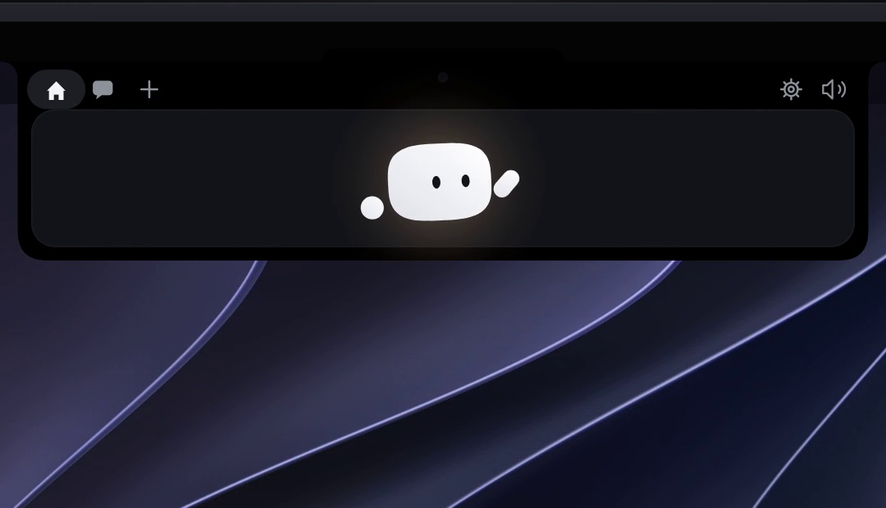

# AIRA

### The Ambient Intelligence Island & Mobile Relay for Autonomous AI Coding Agents
**Keep agent diffs in your peripheral vision, approve actions remotely with biometrics, dictate offline, and stay in deep flow.**

<br>

[](https://github.com/gilangggra/Aira/releases)
[](LICENSE)
[](https://github.com/gilangggra/Aira)
[](docs/VOICE.md)
[](docs/privacy.html)

<br>

<p align="center">
  
</p>

<br>

<table>
  <tr>
    <td align="center">
      <b>🍎 macOS</b><br>
      <code>brew tap gilangggra/aira https://github.com/gilangggra/Aira</code><br>
      <code>brew install --cask aira</code>
    </td>
    <td align="center">
      <b>🪟 Windows</b><br>
      <a href="https://github.com/gilangggra/Aira/releases/download/windows-latest/Aira-Windows-setup.exe"><b>Download Aira-Windows-setup.exe</b></a><br>
      <sub>Per-user installer • Windows 10 & 11 (64-bit)</sub>
    </td>
    <td align="center">
      <b>🐧 Linux</b><br>
      <a href="https://github.com/gilangggra/Aira/releases"><b>Download AppImage / .deb / .rpm</b></a><br>
      <sub>Wayland Layer-Shell & X11</sub>
    </td>
  </tr>
</table>

<br>

[✨ Overview](#-what-is-aira) •
[🤖 Agent Hub](#-1-autonomous-coding-agent-hub) •
[🍅 Airadoro](#-2-airadoro--smart-focus-companion) •
[📱 Mobile Relay](#-3-mobile-biometric-handoff) •
[🎙️ Flow Voice](#-4-flow-voice-suite--meeting-notetaker) •
[🧸 Meet Mochi](#-5-meet-mochi--your-desktop-companion) •
[🚀 Installation](#-installation--downloads)

</div>

---

## 💡 What is Aira?

Working with autonomous AI coding agents like **Claude Code, Antigravity (`agy`), Cursor, Codex, and Gemini CLI** is the future of development—but the context-switching is painful. Constantly flipping between IDE windows just to approve tool permissions, verify bash commands, or check progress fragments your focus.

**Aira turns your hardware notch or desktop edge into an ambient intelligence center:**

```
┌────────────────────────────────────────────────────────────────────────────────────────┐
│                                       AIRA SUITE                                       │
└───────────┬───────────────────────────────┬────────────────────────────┬───────────────┘
            │                               │                            │
 ┌──────────▼──────────┐         ┌──────────▼──────────┐      ┌──────────▼──────────┐
 │  🖥️ DESKTOP ISLAND   │         │   📱 MOBILE RELAY   │      │ 🎙️ FLOW & AIRADORO  │
 ├─────────────────────┤         ├─────────────────────┤      ├─────────────────────┤
 │ • Real-Time Diffs   │         │ • iPhone Dynamic Is.│      │ • Offline Whisper   │
 │ • 1-Click Approvals │         │ • Android Island    │      │ • Parakeet Engine   │
 │ • Jump to Terminal  │         │ • Face ID / Fingerp.│      │ • Meeting Notetaker │
 │ • Mochi Mascot      │         │ • Encrypted P2P Sync│      │ • Pomodoro Timer    │
 └─────────────────────┘         └─────────────────────┘      └─────────────────────┘
```

- **In Your Peripheral Vision**: Aira hugs your MacBook notch or hovers as a sleek transparent island on Windows and Linux. Watch code line additions (`+N / -M`) scroll by without interrupting your typing.
- **Biometric Remote Handoff**: Grab a drink or take a walk while your agent handles long refactors. Aira sends approvals directly to your **iPhone** (Dynamic Island & Face ID) or **Android** phone (Fingerprint).
- **Private Voice Superpowers**: Push a single hotkey to dictate anywhere on your OS with **Whisper Large-v3 Turbo** linked 100% locally. Zero telemetry, zero cloud fees, zero audio leaving your machine.

---

## 🤖 1. Autonomous Coding Agent Hub

Aira hooks directly into your terminal tools using lightning-fast local sockets and named pipes:

<div align="center">
  <table>
    <tr>
      <td width="55%" align="center">
        <b>Live Agent Session Tracking</b><br>
        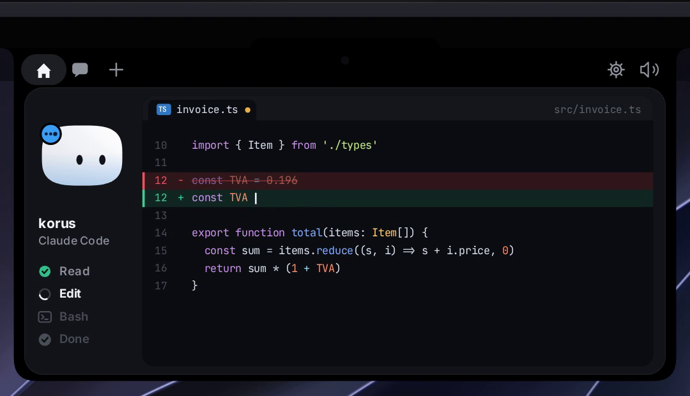<br>
        <sub>Real-time diff tracking, active step indicators, and progress meters.</sub>
      </td>
      <td width="45%" align="center">
        <b>1-Click Approvals & Questions</b><br>
        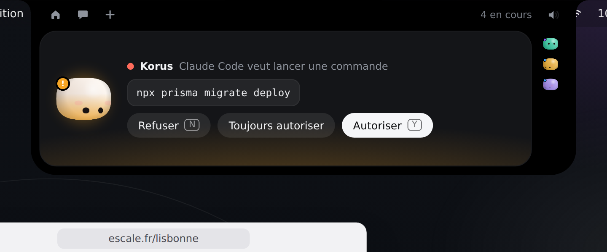<br>
        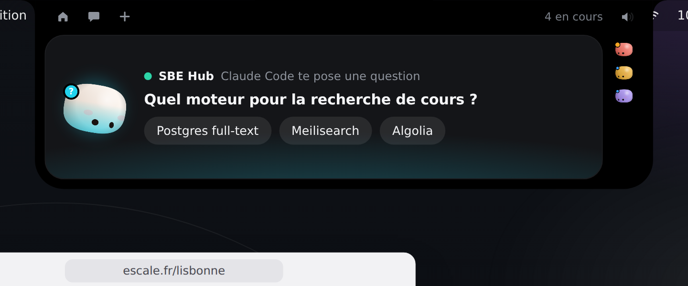<br>
        <sub>Approve bash commands or answer multi-select choices without touching the terminal.</sub>
      </td>
    </tr>
  </table>
</div>

- **Instant 1-Click Permissions**: Authorize tool executions with **Allow**, **Deny**, or **Always** directly from the island.
- **Interactive Multi-Choice Dialogs**: Answer agent questions (`AskUserQuestion`) with clickable single and multi-select options.
- **Jump to Active Terminal**: Click the terminal badge next to any agent to immediately bring the exact terminal window and working directory to the foreground.
- **Subscription Tunneling**: Send AI chat queries through the official CLI tools you already pay for (Claude Code, Antigravity, Codex) without maintaining separate API keys or paying extra per-token fees.

---

## 🍅 2. Airadoro — Smart Focus Companion

High-intensity AI coding sessions require rhythm and intentional rest. **Airadoro** embeds an ergonomic Pomodoro timer right inside the island:

<div align="center">
  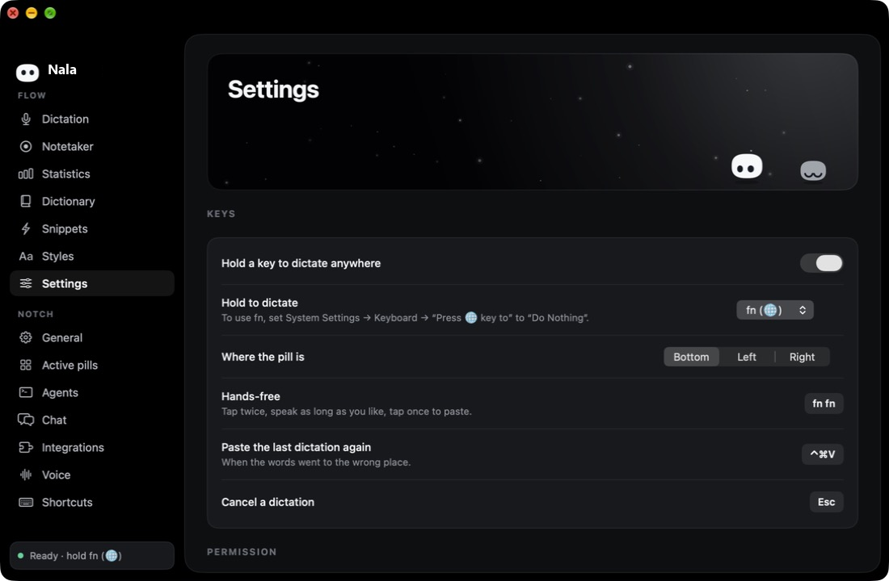
</div>

- **Dual Work & Rest Cycles**: Configurable intervals (default 25 min work, 5 min rest) adjustable from 1 to 60 minutes in Settings.
- **Zero-Drift Timestamp Engine**: Calculates deadlines via `Date.now() + remainingMs`. Time never drifts or loses accuracy even when your laptop sleeps or background threads throttle.
- **Non-Intrusive Presence**: When collapsed, remaining time rests gently next to your agent status pill.
- **Auto-Surfacing & Ambient Chimes**: Plays subtle harmonic chimes and gently expands the island when work ends so you take well-deserved breaks.

---

## 📱 3. Mobile Biometric Handoff

Never let an autonomous agent stall waiting for permissions while you are away from your desk:

<table>
  <tr>
    <th width="50%"><h3>🍎 Aira on iPhone (iOS 18+)</h3></th>
    <th width="50%"><h3>🤖 Aira for Android (Android 11+)</h3></th>
  </tr>
  <tr>
    <td align="center">
      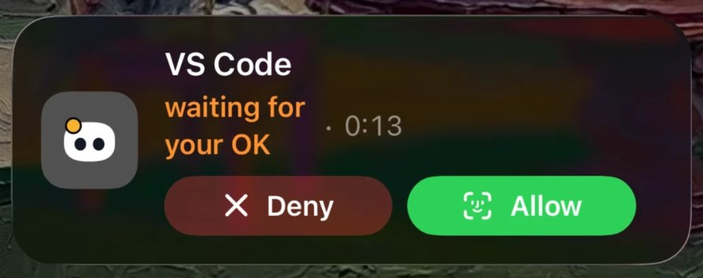<br><br>
      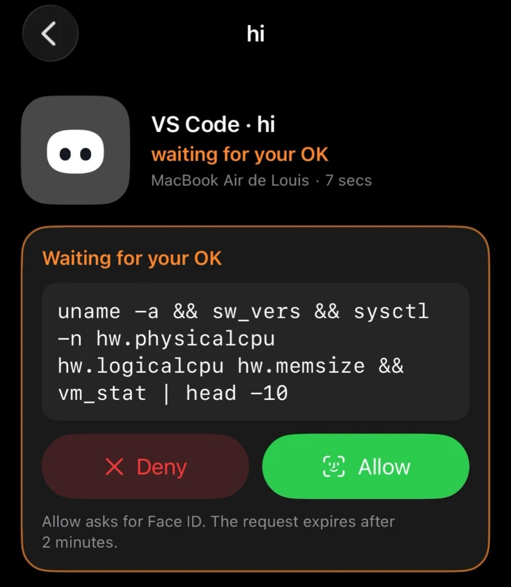
      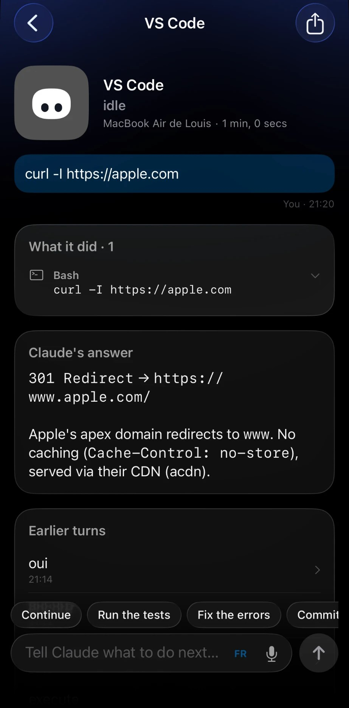
    </td>
    <td align="center">
      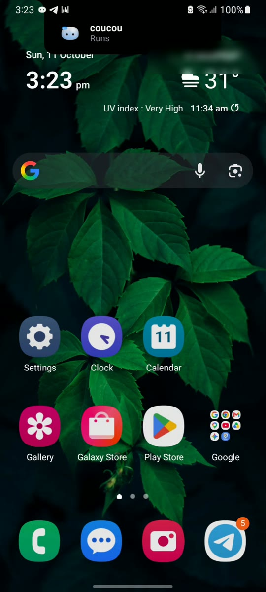<br><br>
      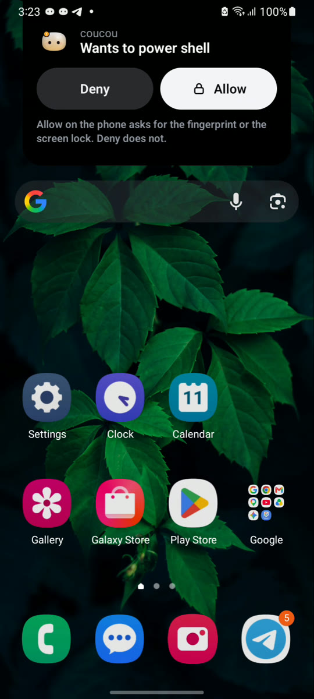
      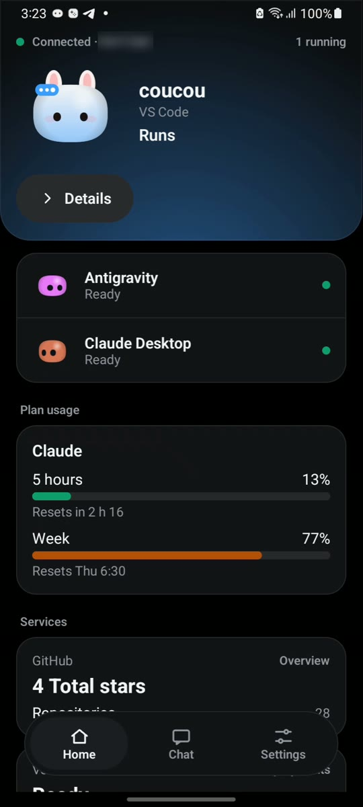
    </td>
  </tr>
  <tr>
    <td>
      <ul>
        <li>🏝️ <b>Dynamic Island & Live Activities</b>: Stream real-time agent output right on your Lock Screen.</li>
        <li>🔐 <b>Face ID Approvals</b>: Approve bash execution with a simple biometric glance.</li>
        <li>☁️ <b>End-to-End iCloud Sync</b>: Synchronizes privately through your personal CloudKit database.</li>
        <li>🧩 <b>Home Screen Widgets & Siri</b>: Follow status and trigger actions with Siri voice commands.</li>
      </ul>
      <p align="center"><a href="docs/IPHONE.md"><b>Read iPhone Documentation →</b></a></p>
    </td>
    <td>
      <ul>
        <li>🏝️ <b>Camera Punch-Hole Island</b>: Dynamic floating overlay docked to your front camera hole.</li>
        <li>🔐 <b>Biometric Approvals</b>: Fingerprint confirmation over any app or lock screen.</li>
        <li>📶 <b>Local Wi-Fi Pairing</b>: Offline direct pairing with TLS pinned certificates.</li>
        <li>🧩 <b>9 Custom Widgets</b>: Agent meters, plan usage gauges, and quick action buttons.</li>
      </ul>
      <p align="center"><a href="android/README.md"><b>Read Android Documentation →</b></a></p>
    </td>
  </tr>
</table>

---

## 🎙️ 4. Flow Voice Suite & Meeting Notetaker

Speak thoughts faster than you type. Aira includes a complete offline speech intelligence suite:

<div align="center">
  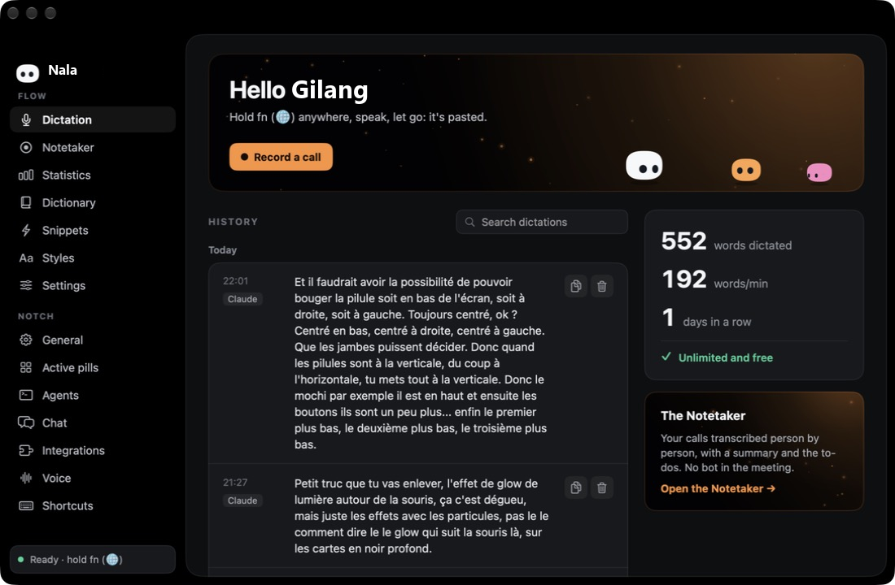
</div>

- **Global Push-to-Talk**: Hold your shortcut anywhere (`Right ⌥`, `fn`, or `Right Ctrl`), speak naturally, and release: words are instantly pasted into the active application.
- **Dual Offline Speech Engines**:
  - 🧠 **OpenAI Whisper Large-v3 Turbo (INT8)**: State-of-the-art accuracy across 99+ languages, including native Indonesian support.
  - ⚡ **NVIDIA Parakeet TDT**: Sub-second latency speech-to-text across 25 Western languages.
  - *100% on-device inference via `sherpa-onnx` and hardware acceleration. Audio never touches external servers.*
- **Private Call Notetaker**: Record calls and conferences directly through your microphone and loopback audio without third-party meeting bots. Generates speaker-separated transcripts and action items locally.
- **Context-Aware AI Formatting**: Automatically strips filler words ("um", "uh") and adjusts formatting based on the destination app (code comments, Slack chat, or professional email).

<table>
  <tr>
    <td width="33%" align="center">
      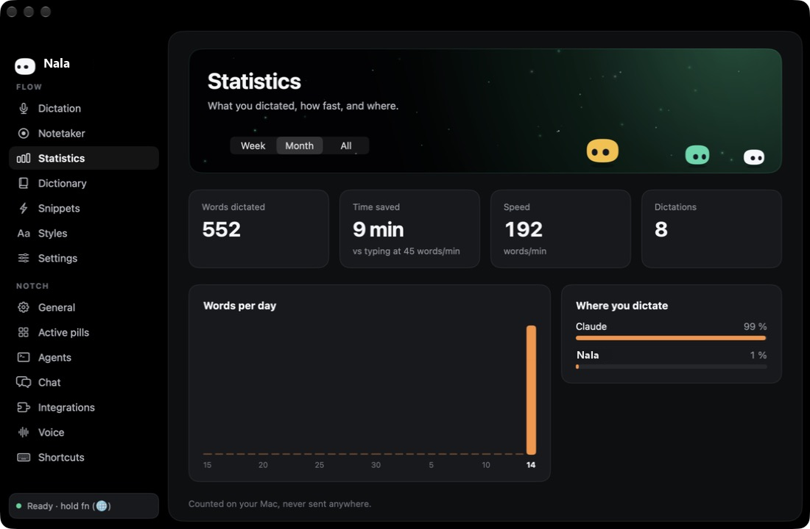<br>
      <sub><b>Local Analytics</b>: Word count, speed (WPM), time saved.</sub>
    </td>
    <td width="33%" align="center">
      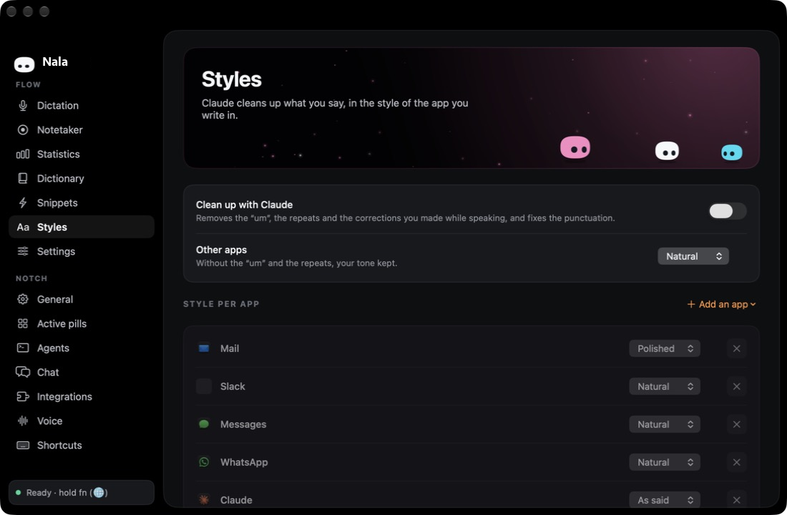<br>
      <sub><b>App-Specific Styles</b>: AI text cleaning adapted per app.</sub>
    </td>
    <td width="33%" align="center">
      <br>
      <sub><b>Hardware Tuning</b>: Model selector, hotkeys, mic gain.</sub>
    </td>
  </tr>
</table>

---

## 🧸 5. Meet Mochi — Your Desktop Companion

Resting at the center of the island is **Mochi**—a charming squircle that brings your workstation to life:

<div align="center">
  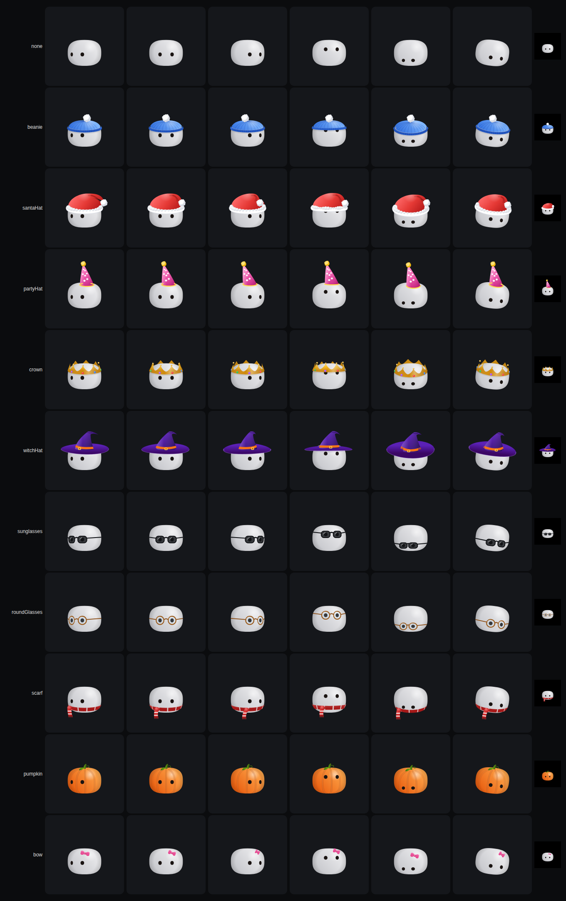
  
  <table>
    <tr>
      <td align="center" width="33%">
        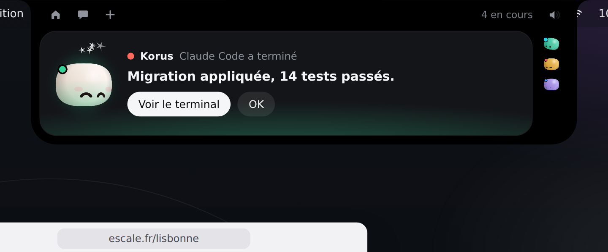<br>
        <sub><b>Celebrates Success</b>: Happy dances when agent tasks finish</sub>
      </td>
      <td align="center" width="33%">
        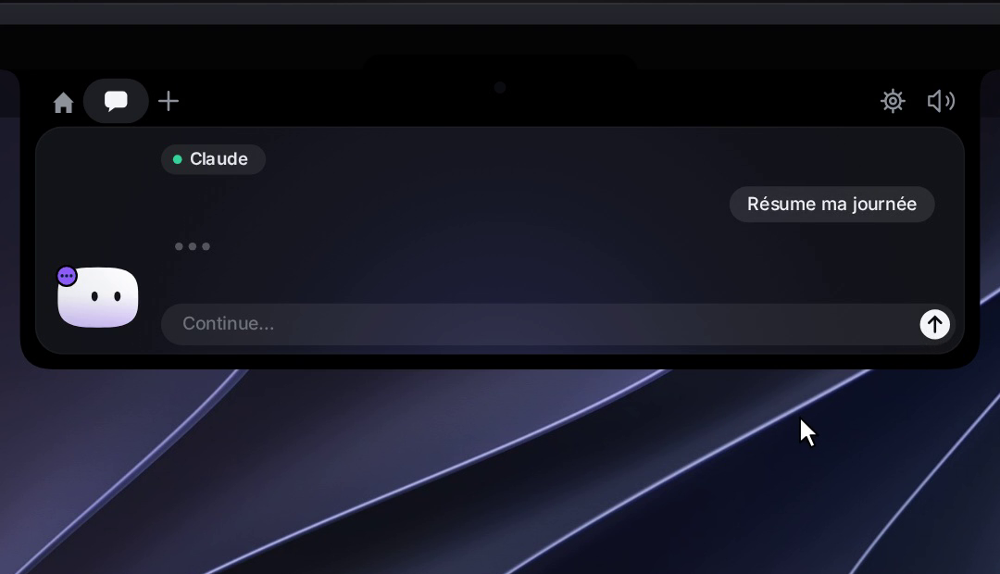<br>
        <sub><b>Contextual Chat</b>: Query models with open diff context</sub>
      </td>
      <td align="center" width="33%">
        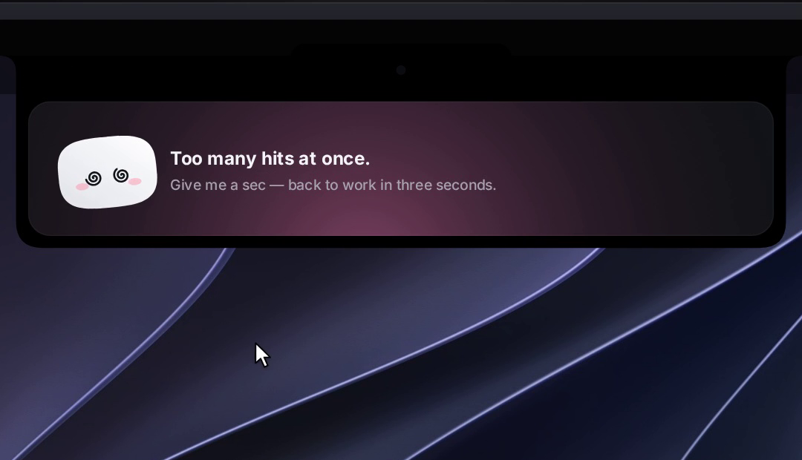<br>
        <sub><b>Expressive Life</b>: Blinks, follows cursor, reacts to taps</sub>
      </td>
    </tr>
  </table>
</div>

- **Reactive Mascot Physics**: Mochi's eyes follow your mouse cursor across screens, blinks naturally, and squishes when tapped.
- **Detachable Desktop Pet**: Click and drag Mochi away from the notch to let him float anywhere on your desktop.
- **Drop-and-Ask**: Drag any file onto Mochi to immediately summarize documents, inspect code, or attach files to active prompts.

---

## 🔌 Supported Agent Integrations

Aira hooks into your developer environment with zero runtime latency:

| Agent / Tool | Capability | Supported OS | Setup Path |
|---|---|---|---|
| **Claude Code** | Live diffs, bash approvals & question prompts | macOS • Windows • Linux | Settings → Claude Code → **Install hooks** |
| **Antigravity (`agy`)** | Island alerts, execution tracking & approvals | macOS • Windows • Linux | Settings → Antigravity → **Install hooks** |
| **Cursor** | Automatic background hook detection | macOS • Windows • Linux | Automatically hooked on launch |
| **Codex CLI** | Step-by-step diff tracking & approvals | macOS • Windows • Linux | Settings → Codex → **Install hooks** |
| **Gemini CLI** | Session progress & execution monitoring | macOS • Windows • Linux | Settings → Gemini CLI → **Install hooks** |
| **Copilot CLI** | Tool execution tracking | macOS • Windows • Linux | Run with `--agent copilot` |
| **Custom Agents** | Open JSON relay socket / pipe | macOS • Windows • Linux | See [docs/AGENTS.md](docs/AGENTS.md) |

---

## 🌐 Platform Support Matrix

| Feature | macOS (15+) | Windows (10/11) | Linux (X11/Wayland) | iOS (18+) | Android (11+) |
|---|:---:|:---:|:---:|:---:|:---:|
| **Island Interface** | Hardware Notch | Floating Island | Layer-Shell / Island | Dynamic Island | Punch-Hole Island |
| **Agent Monitoring & Diffs** | ✅ | ✅ | ✅ | ✅ | ✅ |
| **1-Click Approvals** | ✅ | ✅ | ✅ | ✅ *(Face ID)* | ✅ *(Fingerprint)* |
| **Airadoro Focus Timer** | ✅ | ✅ | ✅ | ✅ *(Widget)* | ✅ *(Widget)* |
| **Flow Voice Dictation** | ✅ | ✅ | ✅ | — | — |
| **Offline Speech Inference** | ✅ *(Whisper/Parakeet)* | ✅ *(Whisper/Parakeet)* | ✅ *(Whisper/Parakeet)* | — | — |
| **Private Call Notetaker** | ✅ | ✅ | ✅ | — | — |
| **Subscription Tunneling** | ✅ | ✅ | ✅ | — | — |
| **Interactive Mochi Mascot** | Full Physics | Desktop Float | Desktop Float | Avatar | Avatar |

---

## 🚀 Installation & Downloads

### macOS
Requirements: macOS 15.0+ (Apple Silicon or Intel 64-bit)

```bash
# Install via Homebrew Cask
brew tap gilangggra/aira https://github.com/gilangggra/Aira
brew install --cask aira
```
*Or download `Aira.zip` from [GitHub Releases](https://github.com/gilangggra/Aira/releases).*

---

### Windows
Requirements: Windows 10 / 11 (64-bit)

- **[Aira-Windows-setup.exe](https://github.com/gilangggra/Aira/releases/download/windows-latest/Aira-Windows-setup.exe)** — Portable / User-level installer (no administrator privileges needed).
- **[Aira-Windows.msi](https://github.com/gilangggra/Aira/releases/download/windows-latest/Aira-Windows.msi)** — System-wide enterprise installer.

---

### Linux
Requirements: X11 or Wayland (supports `gtk-layer-shell` on KDE Plasma, Hyprland, Sway, COSMIC)

- **AppImage (Universal)**:
  ```bash
  chmod +x Aira-Linux-*.AppImage && ./Aira-Linux-*.AppImage
  ```
- **Debian / Ubuntu**: `sudo apt install ./Aira-Linux-*.deb`
- **Fedora / openSUSE**: `sudo dnf install ./Aira-Linux-*.rpm`
- **NixOS**: Run directly via `nix run github:gilangggra/Aira`

---

### Mobile Apps
- **iPhone (iOS 18+)**: Join the [TestFlight Public Beta](https://testflight.apple.com/join/3GpeHv2b).
- **Android (11+)**: Download `Aira-Android.apk` from [GitHub Releases](https://github.com/gilangggra/Aira/releases).

---

## 🔒 Security & Privacy Architecture

```
┌────────────────────────────────────────────────────────┐
│                   Aira Desktop App                     │
│  (macOS: Swift 6 / SwiftUI • Win/Linux: Tauri 2 / Rust)│
└───────────────────────────┬────────────────────────────┘
                            │
            ┌───────────────┼───────────────┐
            ▼               ▼               ▼
┌───────────────────┐ ┌───────────┐ ┌───────────────────┐
│ Local Agent Pipes │ │ Flow Voice│ │  Mobile Sync      │
│  Unix Sockets /   │ │ Whisper / │ │ (iCloud CloudKit /│
│   Named Pipes     │ │  Parakeet │ │  TLS Local P2P)   │
└───────────────────┘ └───────────┘ └───────────────────┘
```

- **Local IPC Communication**: Agents communicate via local Unix Domain Sockets (`/tmp/aira.sock`) or Windows Named Pipes (`\\.\pipe\aira-*`). Code diffs are never broadcast outside your machine.
- **Hardware Vault Encryption**: Credentials and tokens stay protected inside your native operating system vault: **Apple Keychain**, **Windows Credential Manager**, or **Linux Secret Service**.
- **100% On-Device Voice**: Speech models run completely offline on your device's CPU/GPU/NPU.
- **Zero Telemetry**: No tracking cookies, telemetry SDKs, or background analytics.

---

## 🎮 Interactive Cheat Sheet

| Action | Result |
|---|---|
| **Hover Notch / Top Edge** | Peeks out and waves 👋 |
| **Click Island** | Expands full overview & diff inspection panel |
| **Click Mochi** | Squishes with an expressive animated reaction |
| **Triple-Click Mochi** | 😵‍💫 Becomes dizzy temporarily |
| **Drag & Drop File onto Island** | Ingests file and opens prompt drawer |
| **Hold Dictation Hotkey** | Starts offline voice capture; pastes upon release |
| **Say « OK Aira »** | Activates voice assistant mode |

---

## 🤝 Contributing & Community

Aira is open source and proudly built with the community. We welcome contributions, bug reports, and localizations:

- Read our [CONTRIBUTING.md](CONTRIBUTING.md) guide.
- Contribute translations in `NotchBuddy/Resources/Localizable.xcstrings` (macOS) and `windows/src/i18n/` (Windows & Linux).
- Share feedback and feature requests on [GitHub Issues](https://github.com/gilangggra/Aira/issues).

---

## 📄 License & Credits

- **Source Code**: Released under the [MIT License](LICENSE) © 2026 Gilang Ramadan.
- **Character Mascot, Artwork & Audio Assets**: © Gilang Ramadan, all rights reserved (see [LICENSE-ASSETS.md](LICENSE-ASSETS.md)).

<div align="center">

**If Aira brings focus and joy to your coding flow, please give us a ⭐ on GitHub!**

</div>
